# Auditoria visual e funcional — site MDSilva Advocacia

**Data:** 26/11/2026 · **Versão auditada:** branch `claude/marcos-advocacia-site-gbki03` (build de produção local)
**Restrições:** sem merge do PR, sem alteração da trava de produção (`vercel.json`), sem publicação.

## Resumo

| | |
| --- | --- |
| Rotas verificadas | **31** (todas as geradas pelo build) |
| Páginas HTML inspecionadas visualmente | 18 (17 do sitemap + 404), em desktop 1440 px e iPhone 13 |
| Problemas reais encontrados | **3**, todos corrigidos |
| Suspeitas investigadas e descartadas | 2 |
| Regressão após as correções | sem falhas |

## 1. Rotas (31)

| Tipo | Rotas | Resultado |
| --- | --- | --- |
| Páginas | `/`, `/sobre`, 4 áreas, página da campanha, `/conteudos`, 6 artigos, `/contato`, política, termos | 17 × HTTP 200 |
| Página de erro | rota inexistente | HTTP 404, título “Página não encontrada”, `noindex` |
| Imagens Open Graph | `/opengraph-image` + 6 de artigos | 7 × PNG 1200×630, revisadas visualmente |
| Metadados e ícones | `/sitemap.xml`, `/robots.txt`, `/manifest.webmanifest`, `/icon.svg`, `/apple-icon` | 5 × 200 com o tipo de conteúdo correto |
| Interna do Next.js | `/_global-error` | não é acessível publicamente |

## 2. Verificações

| Área | Verificação | Resultado |
| --- | --- | --- |
| Aparência | Rolagem horizontal em 1440 px e 390 px (18 páginas × 2) | nenhuma |
| Aparência | Imagens quebradas | nenhuma |
| Consistência | Cabeçalho, rodapé, tipografia, cores, espaçamentos e componentes entre as páginas | consistente (após correção 2) |
| Navegação | 17 destinos internos a partir de todos os links | nenhum quebrado |
| Navegação | Menu mobile (abre, trava a rolagem, fecha com Esc) e menu suspenso desktop | ok |
| WhatsApp | **125 links** em 17 páginas: número × unidade citada na mensagem | 125/125 coerentes (70 SP · 55 Votuporanga) |
| WhatsApp | Número de atendimento com IA visível com a flag desligada | não aparece |
| Formulário | Sem credenciais: desativado, com aviso e canais alternativos | ok |
| Formulário | Validação, envio rápido, honeypot e falha honesta do provedor | testados na entrega; formulário não alterado nesta auditoria |
| SEO | `title`, `description`, canonical, `og:image` e um único `h1` por página | ok nas 17 páginas |
| SEO | JSON-LD (escritório, unidades, advogado, artigos, FAQ, breadcrumbs) | válido, sem avaliações |
| Acessibilidade | axe-core (WCAG 2.1 AA + boas práticas) nas 17 páginas | 0 violações |
| Desempenho | Lighthouse mobile em `/contato` e `/direito-empresarial` | 92–93 / 100 / 100 / 100 · CLS 0 |
| Segurança | Violações da Content Security Policy | nenhuma |

## 3. Informações institucionais

Texto visível extraído de todas as páginas e comparado com os dados oficiais:

| Dado | Encontrado no site |
| --- | --- |
| Telefones | apenas (11) 98087-8572 e (17) 99170-8236 |
| E-mail | apenas mdireitosilva@yahoo.com.br |
| OAB | apenas OAB/SP 309.058 |
| Formação | Bacharel em Direito, 2005 |
| Endereços | Rua Pedro Severino Junior, 74 – Vila Guarani, São Paulo · Rua Ivaí, 2527 – Jardim Eldorado, Votuporanga |
| Anos citados | 2005 (formação), 2026 (datas) e anos das leis citadas |

Não há biografia, especializações, clientes, depoimentos, resultados, CNPJ, horários ou avaliações inventados.

## 4. Conteúdo jurídico e regras da OAB

Busquei em todo o texto termos sensíveis (garantia, grátis, melhor, especialista, sucesso, vitória, ganhar,
honorários, preço, resultado, indenização, percentuais, urgência e exclusividade) e revisei cada uma das 71
ocorrências no contexto. Todas são:

- **referências legais**: adicional de 50%, indenização de 40% do FGTS, “melhor interesse da criança”, cláusula de
  preço em contratos;
- **negações expressas**: “sem promessas de resultado”, “Nenhuma informação do site representa promessa ou garantia
  de resultado”, FAQ “O contato garante o reconhecimento do vínculo? Não”;
- **avisos de caráter informativo**: Provimento 205/2021, análise individual.

Nenhuma promessa, comparação, divulgação de resultado, oferta, honorário ou linguagem sensacionalista foi encontrada.
As mensagens iniciais de WhatsApp são neutras. **Recomendação mantida:** revisão final dos textos pelo advogado
(checklist em `docs/RELATORIO-ENTREGA.md`, seção 5).

## 5. Problemas encontrados e corrigidos

### 5.1 Contato (celular): espaço reservado do mapa cortava o conteúdo

O bloco “Carregar mapa” tinha proporção fixa (4:3). Em telas estreitas, o ícone era cortado no topo e o aviso sobre
os cookies do Google, no rodapé. **Correção:** o espaço reservado passa a ter altura definida pelo conteúdo (altura
mínima de 16 rem); a proporção fixa vale apenas para o mapa carregado. Arquivo: `src/components/ui/MapEmbed.tsx`.

| Antes | Depois |
| --- | --- |
|  |  |

### 5.2 Páginas de área: grade de temas com células vazias

Com 3 colunas, as áreas com 4, 5 ou 8 temas terminavam com células bege vazias (em Direito Empresarial, duas).
**Correção:** o último tema ocupa as colunas restantes da linha (2 colunas em telas médias, 3 em telas grandes).
Arquivo: `src/components/sections/AreaPage.tsx`.

| Antes | Depois |
| --- | --- |
| 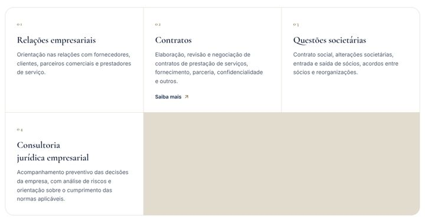 | 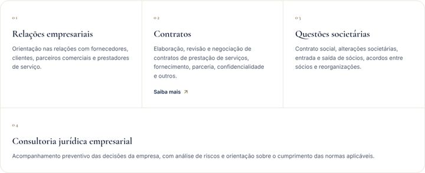 |

### 5.3 Página 404: título genérico

A página de erro exibia o título da página inicial. **Correção:** título “Página não encontrada | MDSilva Advocacia”
e `noindex` coerente. Arquivo: `src/app/not-found.tsx`.

## 6. Suspeitas investigadas e descartadas

- **Capas dos artigos em branco nas capturas:** efeito do carregamento sob demanda (*lazy loading*). Confirmei que as
  capas carregam ao entrar na tela (1200 px de largura natural) em todas as listagens.
- **Acentos “deslocados” nos títulos (ex.: “importância”):** testei com letras isoladas em tamanho grande. É o
  desenho alto e estreito da Cormorant Garamond, e os acentos estão centralizados. Nada a corrigir.

## 7. Observações não alteradas (decisão do escritório)

- Os cartões das unidades exibem “SP” acima de “São Paulo” e de “Votuporanga” (indicação do estado). Está correto,
  mas pode ser trocado por “Unidade” se preferirem.
- As imagens de compartilhamento usam fonte sem serifa (padrão do gerador de imagens), e não a Cormorant do site.
- Em telas estreitas, nomes de área longos ocupam duas linhas no rótulo dos cartões de artigo.

## 8. Capturas das páginas principais (após as correções)

Página inteira: desktop em 1440 px (reduzido para 720 px) e celular em 390 px (iPhone 13).

| Página | Desktop | Celular |
| --- | --- | --- |
| Início | 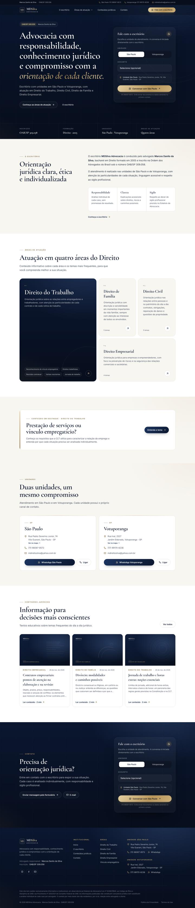 |  |
| O escritório | 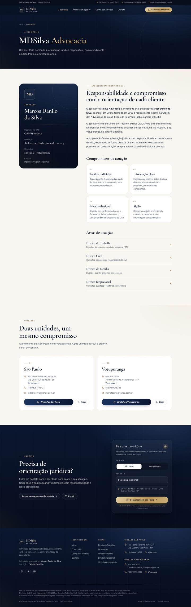 | 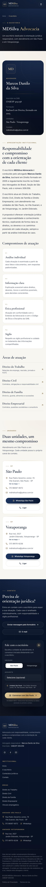 |
| Direito do Trabalho | 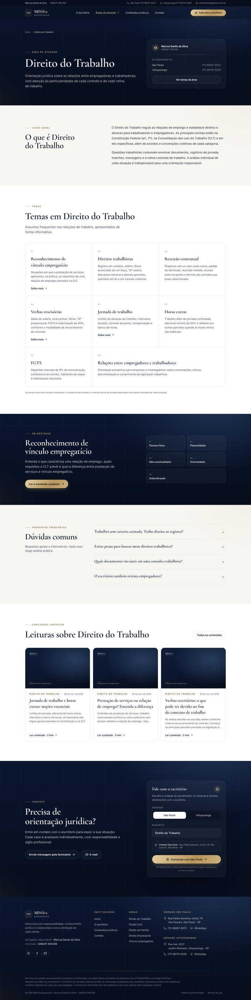 | 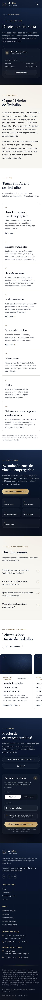 |
| Campanha: vínculo empregatício | 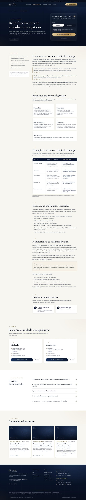 |  |
| Direito Empresarial | 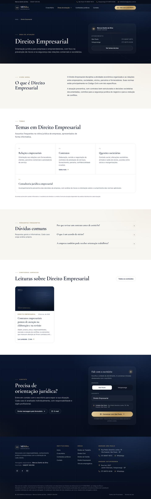 | 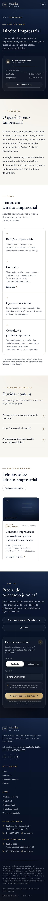 |
| Conteúdos jurídicos | 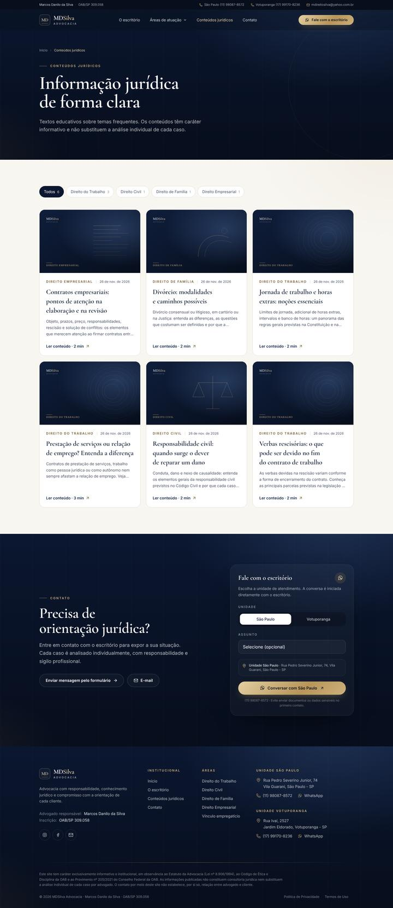 | 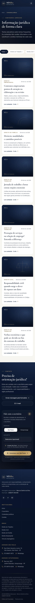 |
| Artigo | 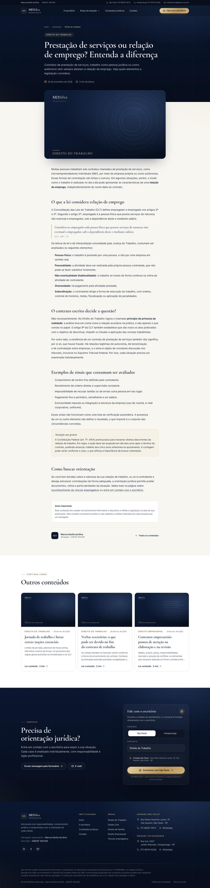 |  |
| Contato |  | 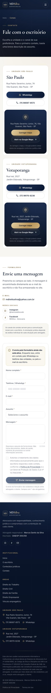 |

## 9. Limitações

Testes feitos em Chromium (desktop e emulação de iPhone 13 e Pixel 7). Recomenda-se conferir em um iPhone (Safari) e
um Android reais após o primeiro deploy de pré-visualização do projeto `marcos-advocacia`.
